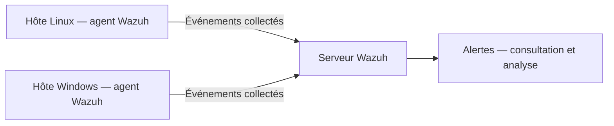

# Wazuh — Centralisation des logs et analyse d’alertes

**Projet académique réalisé dans le cadre du BUT Réseaux & Télécommunications.**

Ce projet porte sur le déploiement d’un serveur Wazuh et d’agents Linux et Windows afin de centraliser des logs, simuler des incidents et analyser les alertes produites. Il mobilise des compétences d’administration système, de supervision de sécurité et d’investigation à partir de journaux.

Ce dépôt présente un travail académique indépendant de tout homelab.

## Périmètre et statut de la documentation

Les réalisations attestées sont :

- Déploiement d’un serveur Wazuh.
- Déploiement d’agents Linux et Windows.
- Centralisation des logs.
- Simulation d’incidents.
- Analyse des alertes.

Ce README est une synthèse de ces réalisations. Les versions, le dimensionnement, les configurations originales, les captures et les résultats détaillés ne sont pas disponibles dans ce dépôt. **Le schéma, les procédures et les scénarios détaillés ci-dessous sont des exemples documentaires : ils ne constituent pas une reproduction vérifiée de l’environnement utilisé ni des preuves de tests exécutés.**

## Objectifs

- Comprendre la chaîne de collecte et d’analyse des événements de sécurité.
- Raccorder des systèmes Linux et Windows à un point de supervision commun.
- Mettre en relation une action simulée, un journal source et une éventuelle alerte.
- Distinguer un événement attendu, une anomalie et un incident à investiguer.

## Architecture logique

Schéma illustratif : le nombre exact d’hôtes et la répartition des composants ne sont pas attestés.



Les agents collectent les événements des sources configurées. Le serveur reçoit ces données et les traite avec les mécanismes de décodage et de règles. La centralisation facilite la recherche d’événements provenant de plusieurs systèmes ; elle ne garantit pas qu’un événement quelconque déclenche une alerte.

## Technologies utilisées

| Technologie | Rôle attesté dans le projet |
| --- | --- |
| Wazuh | Serveur de supervision et agents de collecte |
| Linux | Système accueillant des agents |
| Windows | Système accueillant des agents |
| Journaux système et de sécurité | Sources exploitées pour la centralisation et l’analyse |

La distribution Linux, l’édition Windows, les versions Wazuh et le support de virtualisation ne sont pas précisés. Aucune architecture de production, haute disponibilité ou réponse automatique n’est revendiquée.

## Étapes générales de déploiement

Trame documentaire à adapter à la version retenue :

1. Définir les hôtes à superviser, les sources de logs utiles et les flux réseau nécessaires.
2. Préparer le serveur : résolution de noms, synchronisation horaire, ressources et accès d’administration.
3. Installer les composants Wazuh nécessaires selon la documentation de la version choisie, puis contrôler leur état.
4. Installer les agents Linux et Windows et effectuer leur enrôlement auprès du serveur.
5. Configurer les sources de collecte pertinentes et limiter les communications aux hôtes autorisés.
6. Vérifier la connexion des agents, puis rechercher un événement connu et horodaté.
7. Exécuter les simulations prévues dans un environnement autorisé et analyser les alertes éventuelles.

## Scénarios de tests et incidents simulés

La simulation d’incidents est attestée, mais les scénarios exacts ne sont pas documentés. **Les cas suivants sont des propositions de validation, sans résultat revendiqué.** Ils doivent être réalisés sur des comptes et fichiers de test, dans un environnement isolé et autorisé.

| Exemple de scénario | Précondition | Observation à rechercher |
| --- | --- | --- |
| Quelques échecs d’authentification sur un compte de test | Journal d’authentification collecté ; attention au verrouillage du compte | Événements d’échec et éventuelle alerte selon les règles et seuils actifs |
| Création ou modification d’un fichier de test | Surveillance d’intégrité activée sur un répertoire de test | Événement de changement associé au bon hôte et au bon fichier |
| Arrêt puis redémarrage contrôlé d’un agent | Accès local conservé et interruption autorisée | Changement d’état de l’agent après les délais de détection configurés |
| Action bénigne Windows générant un événement audité | Stratégie d’audit et canal de collecte adaptés | Correspondance entre l’événement Windows et sa réception côté Wazuh |

L’absence d’alerte ne prouve pas l’absence d’événement. Vérifier séparément la génération du log, la collecte, le décodage, les règles et les seuils.

## Méthodologie d’analyse des alertes

1. **Situer l’alerte** : horodatage et fuseau, agent concerné, identifiant de règle, niveau et description.
2. **Revenir à la source** : rapprocher l’alerte du journal local et contrôler la cohérence des champs.
3. **Reconstituer la chronologie** : examiner les événements proches et les répétitions éventuelles.
4. **Qualifier le contexte** : rapprocher l’observation de la simulation ou d’une opération d’administration connue.
5. **Formuler et vérifier une hypothèse** : erreur de configuration, activité attendue ou comportement suspect. Une alerte seule ne démontre pas une compromission.
6. **Conclure avec prudence** : noter les indices, les limites de visibilité et les vérifications complémentaires nécessaires.

Une fiche d’analyse peut contenir : scénario, heure, hôte pseudonymisé, événement source, règle observée, hypothèse, vérification et conclusion. Aucun journal brut ni résultat fictif n’est publié ici.

## Commandes de vérification utiles

Exemples documentaires pour une installation classique ; les noms de services, chemins et ports sont à vérifier sur l’installation réelle. Les commandes ci-dessous contrôlent des états et ne remplacent pas la vérification de la collecte effective.

Sur un serveur Linux avec systemd :

```bash
sudo systemctl status wazuh-manager --no-pager
sudo /var/ossec/bin/agent_control -l
sudo tail -n 50 /var/ossec/logs/ossec.log
```

Sur un agent Linux avec systemd :

```bash
sudo systemctl status wazuh-agent --no-pager
sudo tail -n 50 /var/ossec/logs/ossec.log
timedatectl status
```

Sur un agent Windows, dans PowerShell :

```powershell
Get-Service -Name WazuhSvc
# Nom fictif réservé à la documentation, à remplacer dans le laboratoire.
Test-NetConnection -ComputerName wazuh.example.test -Port 1514
```

TCP/1514 est le port par défaut de communication des agents dans la documentation actuelle ; ce n’est pas une valeur attestée du projet. Un port joignable ne garantit ni l’enrôlement ni la réception d’événements. Ne jamais publier la sortie brute de ces commandes sans examen et anonymisation.

## Compétences démontrées

- Déployer une solution de supervision de sécurité et ses agents.
- Administrer la collecte sur des environnements Linux et Windows.
- Centraliser des journaux pour faciliter leur exploitation.
- Simuler des incidents dans un cadre académique.
- Analyser des alertes et les relier au contexte d’un événement.

## Limites du projet

- Périmètre académique : aucune exploitation en production n’est revendiquée.
- Pas de métrique publiée sur la couverture, le taux de détection ou les performances.
- Pas de preuve fournie pour des règles personnalisées, une réponse automatique ou une intégration externe.
- La qualité de l’analyse dépend des sources collectées, de l’horodatage et des règles actives.
- Le dépôt documente le projet ; il ne fournit pas un déploiement automatisé ni des configurations originales reproductibles.

## Sécurité et confidentialité

Aucun secret n’est publié dans ce dépôt : aucun mot de passe, token, clé privée ou secret d’enrôlement. Aucune IP publique sensible, donnée personnelle, capture réelle ou journal brut n’est inclus. Le nom `wazuh.example.test` est fictif.

Toute future pièce justificative devra être relue et expurgée avant publication, notamment les identifiants d’hôtes, comptes, adresses, chemins personnels et contenus de journaux.

## Références techniques

Les exemples de vérification et les explications de collecte s’appuient sur la documentation officielle. Ces références ne prouvent pas la configuration historique du projet.

- [Architecture Wazuh](https://documentation.wazuh.com/current/getting-started/architecture.html)
- [Connexion et état des agents](https://documentation.wazuh.com/current/user-manual/agent/agent-management/agent-connection.html)
- [Outil agent_control](https://documentation.wazuh.com/current/user-manual/reference/tools/agent-control.html)
